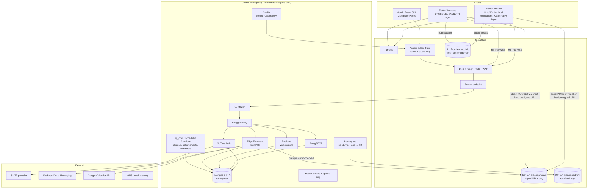

## ⚠️ Blocking finding: your domain depth

You gave `eduapp.shanutechx.com` as the base, which implies hostnames like `api.eduapp.shanutechx.com`. Cloudflare's free Universal SSL certificate covers only **one** subdomain level (`*.shanutechx.com`), not `*.eduapp.shanutechx.com`. Proxied multi-level hostnames therefore need a paid Advanced Certificate (verify current price and plan). Options:

| Option | Hostnames | Cost |
|---|---|---|
| **A (recommended)** | Flat names: `eduapp-api`, `eduapp-studio`, `eduapp-admin`, `eduapp-app`, `eduapp-files` `.shanutechx.com` | Free |
| B | Keep `api.eduapp.shanutechx.com` and buy Advanced Certificate Manager | Paid (verify) |
| C | Buy a separate cheap domain just for FocusLearn | Domain fee |

The rest of this document uses **Option A** as a placeholder. Hostnames will be env-driven, so this is a config change. Sources to verify before Phase 0: Cloudflare docs on Universal SSL coverage and Advanced Certificate Manager.

---

## 1. Architecture diagram



**Key flows**
- **Uploads:** client asks an Edge Function → function checks auth, quota, type and size → returns a presigned PUT (short TTL) → client uploads directly to R2, bypassing Cloudflare's proxied body limit → client calls "confirm" → function does server-side MIME sniffing (range-read of the first bytes), marks `file_objects.status = ready`.
- **Downloads:** Edge Function re-checks authorization (owner, share, or conversation membership) on every request → returns a signed GET URL (about 60–120 s TTL). Revocation of a share is therefore effective within one TTL.
- **Offline:** client writes locally to Drift and queues mutations, then syncs. The server validates everything, and achievements and streaks are computed server-side.

### Storage decision (proposal, to be confirmed in Phase 0)

| | A. Supabase Storage with S3 backend → R2 | B. Custom Edge Function + presigned R2 URLs |
|---|---|---|
| RLS on files | Native (`storage.objects` policies) | Via `file_objects` table + RLS + function checks |
| Direct client→R2 upload | No: uploads pass through Storage API and the proxied domain | **Yes** |
| Proxied body limit | Applies | **Avoided** |
| Quota, MIME sniff, scan hook | Awkward | Natural |
| Complexity | Lower | Higher |

**Proposed: B**, because the proxied body limit and per-user quota/sniffing requirements favor it. Authorization stays in Postgres, since `file_objects` has RLS and the functions use the user's JWT. I will verify A's real behavior in a Phase 0 spike and document the result either way.

---

## 2. Repository structure

```
focuslearn/
├── CLAUDE.md                      # AI-engineer working rules, commands, conventions (created in Phase 0)
├── README.md
├── apps/
│   ├── mobile/                    # Flutter (Android first; shared UI)
│   │   ├── lib/{app,features,l10n,platform}/
│   │   └── android/app/src/main/kotlin/.../   # Alarms, boot receiver, usage access, app picker, lock-task
│   ├── desktop/                   # Flutter Windows
│   │   └── windows/runner/                    # Win32/C++ + FFI: overlay, always-on-top, app launch
│   ├── web/                       # later (placeholder README only)
│   └── admin/                     # React + TS + Vite + TanStack Query + shadcn/ui
├── backend/supabase/
│   ├── config.toml
│   ├── migrations/                # SQL only, no dashboard changes
│   ├── functions/
│   │   ├── _shared/               # zod schemas, authz helpers, r2 client, rate limit
│   │   ├── files-presign/ files-confirm/ files-sign-download/ files-gc/
│   │   ├── account-delete/ invite-redeem/ achievements-compute/
│   │   ├── push-send/ gcal-oauth/ gcal-sync/ admin-*/
│   ├── tests/                     # pgTAP: allowed / denied / anon per rule
│   └── seed/                      # fake data only
├── packages/
│   ├── core/                      # Dart: models, validation, recurrence, calculators, decimal math
│   └── design_system/             # tokens, themes (light/dark), components
├── docs/
│   ├── architecture/ setup/ security/ privacy/ deployment/ user-guides/
│   ├── CAPABILITY_MATRIX.md  LIMITATIONS.md  COSTS.md  THREAT_MODEL.md
│   ├── DATA_INVENTORY.md  RUNBOOK.md  TROUBLESHOOTING.md
│   └── appendix-supabase-cloud.md
├── infra/
│   ├── docker/                    # compose + overrides (pinned image tags), .env.example
│   ├── cloudflare/                # tunnel config, access policies, R2 CORS/lifecycle, turnstile notes
│   ├── backup/                    # backup.sh, restore.sh, verify-restore.sh, retention
│   └── scripts/                   # gen-secrets.sh, hardening checklist, healthcheck
├── test-vectors/                  # calculator + recurrence vectors (JSON, versioned)
└── .github/workflows/             # lint, test, build, dependency audit, secret scan
```

**Tooling:** Melos for the Dart workspace, pnpm workspaces for admin and functions.

**Shared vs native:**

| Shared (Dart) | Native Kotlin (Android) | Native C++/FFI (Windows) |
|---|---|---|
| Models, validation, recurrence, calculators, sync engine, UI, i18n | Exact alarms, boot reschedule, battery/OEM checklist helpers, UsageStats, installed-app picker, lock-task (managed only), FCM handling | Overlay/full-screen window, always-on-top, launching approved apps, foreground-process sampling, Focus Session integration (if supported) |

**Trust rule:** anything that must be trusted (roles, quotas, achievements, share access) lives in Postgres or Edge Functions. Clients only display and cache.

---

## 3. Platform capability matrix (initial hypothesis)

Legend: **FS** fully supported · **UP** supported with user permission · **MD** managed devices only · **VO** voluntary only · **NS** unsupported. Everything here is **unverified until Phase 7**; the matrix gets updated with real-device results.

| Feature | Android | Windows | iOS (later) | Web (later) |
|---|---|---|---|---|
| Auth, profile, sessions | FS | FS | FS | FS |
| Timetable, notes, chat, calculators | FS | FS | FS | FS (offline limited) |
| Offline cache and queued sync | FS | FS | FS | UP (browser storage can be evicted) |
| Local reminders | **UP** (notification permission; exact alarm permission; battery and OEM settings affect reliability) | UP (app must be running or have a registered task; verify mechanism) | UP (strict limits) | NS when tab closed |
| Alarm after reboot | UP (needs boot receiver; some OEMs block it) | VO (depends on startup entry) | NS for custom alarms | NS |
| Alarm while device is off | **NS** | **NS** | NS | NS |
| Push (generic payload) | FS via FCM | **Evaluate:** in-app Realtime while running + local notifications; WNS only if packaged and registered | later | Web Push, later |
| Focus mode timer and nudges | FS (VO) | FS (VO) | VO | VO |
| Always-on-top timer | UP (overlay permission, optional) | VO (window flag; user can close) | NS | NS |
| Open class link in Zoom/Meet/browser | FS | FS | FS | FS |
| Installed-app picker | UP (Android 11+ package visibility; `QUERY_ALL_PACKAGES` is Play-restricted, so prefer a `<queries>` allowlist) | FS (read installed apps list) | NS | NS |
| Usage monitor (own report) | UP (Usage Access, revocable consent) | UP (foreground-process sampling; verify what is legally and technically supported) | NS | NS |
| Blocking or overlay on non-allowed apps | VO via warning nudge; Accessibility overlay **only if** disclosed and Play-policy approved | VO (overlay warning; user can dismiss) | NS | NS |
| Hard app lockdown | **MD** (Device Owner, lock task mode) | **MD** (Assigned Access/kiosk, admin policy) | MD (MDM, out of scope) | NS |
| Prevent app closing / user switching | **NS** on personal device | **NS** on ordinary desktop app | NS | NS |
| Emergency calls and exit procedure | FS (always allowed) | FS | n/a | n/a |
| Google Calendar sync | FS (server-side OAuth) | FS | FS | FS |
| Secure token storage | FS (Keystore) | UP (DPAPI via secure storage; documented fallback) | FS | NS (weaker) |

---

## 4. Phase 0 plan

### (a) Plan

| Step | Work | Output |
|---|---|---|
| 0.1 | Monorepo scaffold, `CLAUDE.md`, CI skeleton (lint, secret scan, dependency audit) | Repo that passes CI |
| 0.2 | Docs: capability matrix, threat model (STRIDE), data inventory, `LIMITATIONS.md`, `COSTS.md` with verify flags and source URLs | `docs/*` |
| 0.3 | Supabase compose: pinned image tags from the official repo, `.env.example`, `gen-secrets.sh` (JWT secret, anon and service keys, DB password) | One-command boot |
| 0.4 | Trim services: evaluate disabling analytics/Logflare, imgproxy, vector, if safe, to save RAM | Resource measurement doc |
| 0.5 | Cloudflare: DNS, Tunnel (`cloudflared`), Access policies (Studio, admin), Turnstile site config, WebSocket test and tunnel-drop reconnect test | `infra/cloudflare/*` + test notes |
| 0.6 | R2: three buckets, scoped API tokens, CORS for presigned PUT, lifecycle rules, public bucket only for non-sensitive assets; presign spike (Option A vs B) | Decision record |
| 0.7 | SMTP: compare free tiers (Brevo, Resend, Mailjet, Amazon SES, others), SPF/DKIM/DMARC setup, send a real verification email | Chosen provider + DNS records |
| 0.8 | Backups: `pg_dump` → `age` encrypt → R2 backup bucket, retention script, **restore drill into a clean instance**, documented | `RUNBOOK.md` |
| 0.9 | Hardening checklist: firewall or Tunnel-only, SSH keys, fail2ban, unattended-upgrades, Postgres not exposed | `docs/security/hardening.md` |
| 0.10 | Health checks (`/health` script, disk alert, tunnel status, uptime ping) and the schema draft migration (empty baseline) | Green health dashboard |

### (b) Files created or changed
`CLAUDE.md`, `README.md`, `.github/workflows/{ci,secrets,audit}.yml`, `infra/docker/{docker-compose.yml,docker-compose.override.yml,.env.example}`, `infra/scripts/{gen-secrets.sh,healthcheck.sh,harden-ubuntu.sh}`, `infra/cloudflare/{tunnel-config.yml,access-policies.md,r2-setup.md,r2-cors.json,turnstile.md}`, `infra/backup/{backup.sh,restore.sh,verify-restore.sh}`, `backend/supabase/{config.toml,migrations/0000_baseline.sql}`, and the docs listed above.

### (c) Assumptions
1. Production runs on a **small VPS**, and a home machine is for dev/pilot only.
2. The domain's DNS is (or can be moved to be) on Cloudflare.
3. Ubuntu 22.04/24.04 LTS, Docker Engine and the Compose plugin.
4. Initial scale: a pilot of tens to a few hundred users, and growth is not designed for beyond that in Phase 0.
5. English UI first, with ARB structure ready for Sinhala and Tamil.
6. Distribution: sideloaded APK first, Play Store later (which triggers policy review for any Accessibility or usage features).
7. Phase 0 exit: `docker compose up` brings the stack healthy, the API answers at the tunnel hostname, a test email arrives, an R2 presigned upload works, and a backup restores into a fresh instance.

### (d) Questions (blocking only)
1. **Hostnames:** Option A, B or C above? Is `shanutechx.com` already on Cloudflare DNS, and which Cloudflare plan?
2. **Host:** VPS or home machine for Phase 0? If a VPS, which provider, region and size? If a home machine, what OS, RAM and CPU?
3. **Registrar:** where is the domain registered? (It matters only if the nameservers must move to Cloudflare.)
4. **SMTP:** any existing account, or should I pick from the comparison?
5. **Expected users:** pilot size and a rough upper bound within 12 months?
6. **Devices for testing:** which low-end Android phone (model, Android version) and which Windows laptop (spec) will you have for Phase 7 verification?
7. **Team and review:** are you the only developer? Who will do the legal review of privacy documents (Sri Lanka PDPA)?
8. **Google sign-in and Calendar:** do you already have a Google Cloud project, or should I leave this for Phase 6?

---

## 5. Draft database schema outline and security model

### Conventions
Every table has `id uuid pk`, `created_at`, `updated_at` (trigger), and `deleted_at` where soft delete applies. Foreign keys are explicit, with `on delete` rules documented. Event times are `timestamptz` (UTC) plus an `iana_tz text`. All tables in `public` have RLS **enabled and forced**. Default: no policy, so deny.

### Schema outline

| Area | Tables | Key columns / constraints | RLS rule (summary) |
|---|---|---|---|
| Identity | `profiles` | `user_id` (fk auth.users), `display_name`, `avatar_key`, `stream`, `birth_year`, `is_discoverable` (default false if <18), `tz` | Read own; read others only if friend, shared group member, or discoverable and not blocked. Update own, excluding privileged columns. |
| | `devices`, `push_tokens` | `user_id`, `platform`, `token_hash/encrypted`, `last_seen`, `revoked_at` | Owner only; tokens never selectable by clients |
| | `user_preferences`, `consents` | `user_id`, `kind`, `version`, `granted_at`, `revoked_at` | Owner read/write; consents append-only |
| Social | `friendships` | `user_a`, `user_b` (canonical order), `status`, unique pair | Parties only; blocked means no insert in other tables via a helper `not_blocked(a,b)` |
| | `groups`, `group_members` | `role` enum (owner/admin/moderator/member), invite code hash, `invite_expires_at`, `revoked_at` | Members read; role changes only via SQL function checking caller role |
| Planner | `subjects`, `topics` | owner or group scope, `stream` | Own and group-visible reads |
| | `timetable_events` | `start_utc`, `end_utc`, `iana_tz`, `category`, `visibility`, `meeting_url`, `owner_id`, `group_id` | Owner full; group members read when `visibility=group` |
| | `event_recurrences`, `event_exceptions` | `rrule`, `exdate`, `override_event_id`, scope (this / this+following) | Inherit parent event access |
| | `assignments` | `due_utc`, `status`, `subject_id` | Owner |
| Focus | `study_sessions` | `started_at`, `ended_at`, `planned_s`, `validated_s`, `client_reported_s`, `status`, `client_uuid` unique (idempotent sync) | Owner insert/read; **`validated_s` writable only by server function** |
| | `achievements` | `user_id`, `kind`, `earned_at`, computed server-side | Owner read; no client write |
| | `focus_policies`, `allowed_app_profiles`, `allowed_app_entries` | `scope` (user/group/global), `platform`, `package_or_exe` | Read by subjects of the policy; write by policy owner/admin via function with audit |
| | `device_enrollments` | `device_id`, `level` (managed), `consent_id`, `enrolled_by`, `revoked_at` | User sees and can revoke own; admin sees only enrolled devices |
| Notes | `notes` | `owner_id`, `body`, `search_tsv` (GIN), `version`, folder/tags | Owner; shared via `note_shares` |
| | `note_shares`, `note_versions` | `grantee_user/group`, `permission` (read/edit), `revoked_at` | Immediate effect on revoke; versions follow note access |
| Chat | `conversations`, `conversation_members`, `messages`, `message_attachments` | `kind`, `last_read_at`, `edited_at`, `deleted_at` | Members only, via `is_conversation_member()`; block check on insert; rate limit in function |
| Files | `file_objects`, `user_quotas` | `r2_key`, `owner_id`, `size`, `sniffed_mime`, `status`, `scan_state` | Owner read metadata; bytes only via signed URL after the authz function |
| Platform | `notifications`, `calendar_connections` | tokens **encrypted, never selectable by clients** | Owner reads non-secret fields; secrets: service role only |
| | `formula_entries` (+ versions) | `status` draft/review/published | Everyone reads published; educators write via function |
| Ops | `audit_logs`, `reports`, `rate_limit_events`, `deletion_requests` | audit append-only (before/after JSON, actor, IP, request id) | Audit: admin read via function, no update or delete. Reports: reporter inserts, moderators read. |

### Security model
1. **Roles:** `anon` (almost nothing), `authenticated` (own data + shared scope), `service_role` (server only, never in any client or browser). Application roles (group roles, educator, admin) live in tables and are checked **inside SQL functions and RLS**, never from client-supplied claims.
2. **Helper functions:** `is_group_member(gid)`, `has_group_role(gid, role)`, `is_conversation_member(cid)`, `can_read_note(nid)`, `not_blocked(a,b)`: `STABLE`, `SECURITY DEFINER` only when needed, with `set search_path = ''` and input validation.
3. **Privileged writes** (role changes, achievement grants, session validation, policy changes, enrollment) go through functions that write an `audit_logs` row in the same transaction.
4. **Admin:** Cloudflare Access (SSO or email OTP) plus Supabase Auth with required MFA (AAL2) and re-auth for privileged actions. Admin UI only calls Edge Functions or RPCs, never table writes with a broad key.
5. **Files:** private buckets, no public listing, signed URLs about 60–120 s, keys stored in Postgres, never URLs.
6. **Rate limiting:** `rate_limit_events` plus function-level checks for auth-adjacent actions, invites, uploads, reports and message send. Turnstile on signup, login and reset.
7. **Testing:** every policy has pgTAP cases for allowed user, denied user and anon. Cross-user leak tests cover notes, messages, calendar tokens, device info and files.
8. **Privacy by default:** under-18 profiles are private and undiscoverable. No ads or data sale. Generic push payloads. Consent records are versioned and revocable. Account deletion cascades to R2 objects through `deletion_requests` and a GC job.
9. **Honest claims:** TLS in transit. At rest depends on the VPS disk (I'll document whether LUKS or provider encryption is actually on). **No end-to-end encryption claim.**

---

## 6. Risks and assumptions

| # | Risk | Mitigation |
|---|---|---|
| 1 | Multi-level subdomain TLS (see top) | Flat hostnames |
| 2 | Home-machine hosting: sleep, power, ISP outages, no redundancy | VPS for production; home for dev/pilot only |
| 3 | Supabase stack RAM. The compose runs roughly a dozen containers. My working estimate is **4 GB RAM, 2 vCPU, 40+ GB disk minimum (verify)** | Measure in 0.4, trim optional services |
| 4 | Realtime over Tunnel: WebSockets are supported, but drops need client reconnect and resubscribe logic | Test in 0.5; chat falls back to refresh |
| 5 | Android reliability on budget phones (OEM task killers, Doze) | Reliability checklist screen; never promise alarms when off |
| 6 | Play Store policy for Accessibility, exact alarms (`USE_EXACT_ALARM` is restricted to alarm/calendar apps, verify) and `QUERY_ALL_PACKAGES` | Sideload first; document justification and fallback |
| 7 | Windows push has no first-class FCM path | Evaluate WNS vs Realtime + local notifications; document limits |
| 8 | Enforcement expectations: users may assume "locked" phones | Three clearly named levels; plain-language limits in UI and docs |
| 9 | Minors and the PDPA No. 9 of 2022 (phased implementation) | Privacy-by-default; **lawyer review flagged** for consent texts, age handling, retention and breach notification |
| 10 | Free-tier numbers (R2, SMTP, FCM, Google APIs) change | Every figure marked "verify before deployment" with a source URL in `COSTS.md` |
| 11 | Scope: ten phases is large for one team | Strict phase gating; each phase ships runnable and tested |
| 12 | Supabase upgrades breaking self-hosted config | Pinned tags, staging test, rollback in runbook |
| 13 | Sinhala/Tamil rendering and long strings | ARB structure now; font and layout tests in Phase 1 |

**Cloudflare facts to verify before Phase 0 sign-off** (I have not checked these live): the proxied request-body size limit for your plan, Tunnel and Access free-tier limits, R2 free allowance and operation pricing, and Turnstile limits.

---

